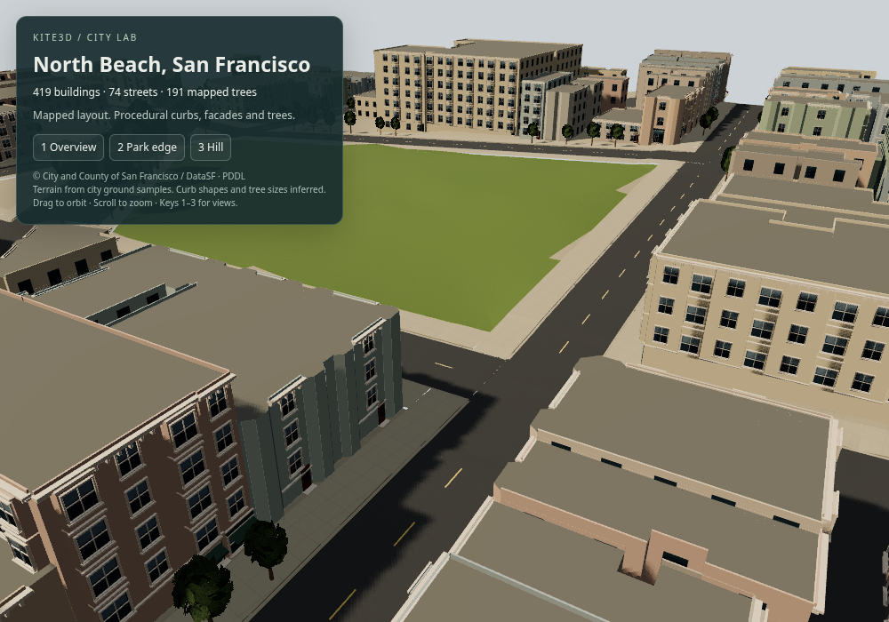

# San Francisco city slice

An editable North Beach / Washington Square dataset and offline city baker for Kite3D. The checked-in scene contains 419 buildings, 74 street segments and 191 mapped street trees in an approximately 500 x 334 m area.

This iteration adds a reusable SF-inspired facade kit, foliage cards, tiled ground materials, directional shadows and ambient occlusion to the street-contact milestone. It remains a procedural approximation below BeamNG.Earth's visual fidelity, not a realistic reconstruction.



## Run

From this repository, after its normal build:

```sh
cd examples/sf-city
npm run city:build
node ../../packages/kite3d/dist/cli.js dev --no-open
```

Or copy this directory into a standalone project, run `npm install`, then `npm run dev`. Open `assets/main.scene.gltf`. Play provides three camera bookmarks, instances the repeated tree models and batches the generated surfaces by tile/material. Stop restores the authored objects and camera. Each building, road and tree is independently selectable in the saved scene.

## Rebuild and improve

`npm run city:build` is offline and uses the checked-in source snapshot. `npm run city:fetch` explicitly refreshes the four bounded DataSF queries. Fetching never runs automatically during play or build. Coordinates use a local flat approximation for this bounded slice, X east, Y up, Z south, around the origin in `scene/area.json`. Vertical values are city ground heights in NAVD88 metres, minus `verticalOriginM`; they are not WGS84 ellipsoid heights.

`scene/generated.json` records source IDs, assumptions, per-feature hashes, inferred/measured fields, logical 128 m ownership groups and the asset placements. It is generated output. `scene/collision.json` contains separate terrain triangles and footprint prisms for later physics integration. The renderer does not consume that collision file yet.

Put durable changes in `scene/overrides.json`, keyed by a feature ID from the generated manifest. For example:

```json
{
  "version": 1,
  "features": {
    "sf-building:201006.0001265": {
      "heightM": 25,
      "facadeColor": "#b7c8c2"
    },
    "sf-road:2546000": {"widthM": 4, "sidewalkM": 0}
  }
}
```

Buildings and trees also accept `asset`, a project-relative path to an authored `.gltf`, and all feature types accept `hidden`. A replacement building asset uses a metre-scale, Y-up origin at the footprint vertex-average centre and generated base elevation. A replacement tree is 10 m tall before its placement scale is applied. Do not edit generated model files directly. Unchanged output files retain their bytes and modification times. Unknown override IDs are reported in `generated.json` for reconciliation after source refreshes.

The composer also preserves saved editor changes to existing placement names, TRS transforms and asset references by comparing them with their previous generated values. It preserves unknown node extras, light extensions, document fields and asset registrations, including editor-added IDs and replacements of existing registrations. Unused registrations are retained deliberately; removing an asset is an explicit editor operation. Generation controls asset membership: use `hidden` for durable removal. Overriding a generated placement in the editor takes precedence over subsequent placement defaults until reconciled.

## Source snapshot and limits

All four layers come from the City and County of San Francisco's DataSF portal, with PDDL as recorded in its catalogue. Query URLs, capture time, dataset IDs and snapshot hashes are in `scene/sources/provenance.json`.

| Layer | Dataset | Used here |
| --- | --- | --- |
| Buildings | [ynuv-fyni](https://data.sf.gov/d/ynuv-fyni) | Footprints, median relative heights, ground elevation samples |
| Streets | [3psu-pn9h](https://data.sf.gov/d/3psu-pn9h) | Active centrelines, names and connectivity |
| Trees | [tkzw-k3nq](https://data.sf.gov/d/tkzw-k3nq) | Locations, species labels and trunk-diameter field |
| Sidewalks | [4g86-grxu](https://data.sf.gov/d/4g86-grxu) | Positive actual widths (`SIDEWALK_F`), converted from feet |

Footprints and elevation attributes have older acquisition dates; a recent portal refresh is not a new survey. Ground is an interpolation of footprint ground samples, lightly flattened across roads. No 2023 LiDAR or roof reconstruction is processed yet. The authored facade kit fits projecting bays, window frames, cornices, entrances and shop awnings to footprints using street-facing heuristics. These details, facade colours, flat roofs, road widths/markings and tree sizes/shapes are inferred, not observations of each address. Broadleaf trees use an original procedural leaf texture on reusable cards; species labels do not imply accurate species models. The lawn is an explicitly authored approximation. Asphalt grain, concrete slab seams and grass swatches are original procedural textures, not aerial imagery. For sidewalks, `SIDEWALK_F` is the actual width; zero/negative entries use defaults. `WIDTH_MIN` and `WIDTH_RECO` are planning recommendations and are not used as measurements. Sidewalks are clipped out of carriageways, with deterministic ownership where street surfaces overlap. Raised curb faces are 15 cm, with 1.8 m lowered crossing approaches and 30 cm drainage margins. These dimensions and transition shapes are heuristic, not surveyed curb returns or an accessibility compliance claim. Rendered terrain is cut out beneath streets and sidewalks to prevent coarse terrain triangles poking through on hills; the separate collision terrain remains continuous. Rounded curb returns, building-front corridor fitting, street furniture and traffic remain unimplemented. Logical tile groups are not a production streaming/LOD system.

## Next quality milestones

1. Replace interpolated ground with a datum-aligned LiDAR terrain crop and fit road/intersection heights.
2. Fit street widths against building fronts and connect the clipped approaches with rounded, surveyed curb returns.
3. Refine the facade families with measured roofs, fire escapes and address-specific corrections; author the church as a landmark.
4. Replace tree placeholders with a reusable species library and add mapped/inferred street furniture.
5. Bake render LODs, integrate collision/navigation, then measure a fixed route on target browsers.

Keep the semantic IDs and overrides through each upgrade. Geometry is a rebuildable output.

## Standalone demo export

After the repository build, run `npm run city:export` here. Serve `dist/` with a static HTTP server. The export validates the project with the installed engine and uses its dependency import map and runtime. It includes only the scene, models reachable through its active asset references and their resources, runtime entry, generated manifest and runtime bundle. It excludes source snapshots, overrides, generator scripts, editor state and credentials. The content-hash upload manifest is kept separately in `.kite3d/release.json`.

The requested destination is the user's existing Teenyapp project. No verified public deployment exists: the service rejected the authorized agent briefing with HTTP 403 / Cloudflare 1010. Publishing is paused until that service restriction is resolved. No credentials or project contents are included in this export.

## Validation (2026-10-22)

- Root build, typecheck, lint, eight Node script checks and all ten Kite3D CLI tests pass. The build emits existing vendored ThreePipe typed-array declaration diagnostics despite returning success. `npm ci` omitted the pinned `three` tarball in this environment; restoring that exact tarball allowed the build without changing versions.
- Focused regressions cover preserved user registrations/replacements, unknown light extensions, the direct runtime dependency, crossing clipping and lowered approaches, authored descendants and replacements during batching, unreachable private export assets, and stale hidden overrides.
- Browser checks cover three Play/Stop cycles, saved edits, regeneration and reload with a custom asset registration and added object intact, plus camera bookmarks, standalone orbit/zoom, interrupted load, a failed manifest fetch and reload recovery. Editor-only font and optional meshopt CDN requests hit certificate errors here; the uncompressed scene renders. The standalone export reports no page errors.
- The final local 1000 x 700 Chromium/SwiftShader sample reached the HUD in 32.3 seconds: `main()` began at 27.4 seconds and completed geometry merging at 29.6 seconds. Asset loading and initial rendering dominate readiness. This is a single software-rendering sample, not a hardware FPS or download budget. The scene has 604,580 placed triangles, 410 visible runtime meshes plus the sun, and a 47.0 MB uncompressed export. An instrumented street-view frame issued 601 WebGL draw calls across passes. The broadleaf template uses 180 triangles including its trunk; alpha-tested foliage still adds overdraw.
- Profiling caught 1,411 original multi-material building meshes bypassing batching. Emitting separate baked leaf nodes removed those from the live authored tree; the final standalone scene has zero visible authored meshes alongside its runtime batches. Owner-added objects are excluded from that baseline and remain visible in the separate lifecycle fixture.
- Before/after park-edge views are in `validation/`. The original comparison shows removed cross-street sidewalks and terrain poke-through. `facade-after.png` and `park-facade-after.png` show the latest facade, vegetation, materials and smoothed terrain iteration. This is visual validation, not an FPS budget or a surveyed reconstruction.

To run the small regression suite from the repository root: `node --test scripts/sf-city.test.mjs`.

### Grant Avenue photo study (local visual iteration)

The `photoFacade` override on `sf-building:201006.0004170` replaces a 24 m portion of its Grant Avenue wall with the authored study. The semantic ID and original source snapshot remain. The explicit `photoFacade.flattenCorner` override flattens the south corner to better match the photograph; generated footprint, roof and collision prism follow this inferred correction. Remove that flag to restore the mapped corner. This is not a surveyed correction. Parcel association is documented in `scene/sources/grant-parcel-provenance.json`; the partial-frontage offset is inferred, not surveyed. A level shop floor and downhill plinth meet the interpolated ground. The fourth Play bookmark visits this frontage and Stop restores the previous camera, including its field of view and view offset.

The visual reference is Dennis Hearne's photograph in Figure 128 of the North Beach Historic Context Statement, linked in `scene/photo-study.json`. Reference pixels are not distributed. Original inferred shop lettering, notices, unseen interiors and the opposing-street reflection environment are approximations. This remains an unfinished photo match. The parked row now uses separately editable BMW X5 and Tozzo sedan assets, credited under `assets/models/vehicles/`. They are licensed substitute models, not identifications of the photographed cars. The Grant segment uses a photo-derived 9 m carriageway and 1 m sidewalk estimate. This replaces the prior 6 m heuristic and the block-level 2.1336 m sidewalk value; it is not a surveyed correction. Vehicle placement follows this curb and ground slope.

The street environment is authored in `assets/environments/grant-street/source.js` and baked into `street.hdr`. It supplies reflection detail during Play when no user environment is already set, and is removed on Stop. It is not a photographic HDR. Authoring source/archive files are excluded from the runtime export; only referenced runtime resources and the explicitly allowed environment map are copied.

The photo study also adds an estimated north elevation to mapped building `sf-building:201006.0011021` and sash/shop openings on the foreground building corner. Footprints and recorded heights remain the inputs; historical business identity, opening positions and finishes are not surveyed. The distant tower and exact background silhouette remain unfinished.

Retained wall triangles face away from the solid building volume. This fixes the diamond-shaped self-shadow artifact found during manual photo comparison. Runtime shadows use a camera-target-focused frustum at street scale; Stop removes its camera listener and restores the authored scene.
